# Post-contenido — Unidad 11: Buenas Prácticas y Patrones de Diseño

## Descripción
Repositorio del laboratorio de la Unidad 11 de Programación Web —
Séptimo Semestre. Contiene un único proyecto Maven Spring Boot
(pedidos/) que parte de un código con violaciones reales de SOLID
(SRP y DIP), SQL embebido y una entidad JPA expuesta directamente en
la API, y lo refactoriza aplicando arquitectura en capas, el patrón
DTO, inyección de dependencias por constructor y el patrón Strategy
para el descuento por tipo de cliente. Se extiende con manejo
centralizado de errores, logging (SLF4J/Logback) y documentación de
la API (springdoc-openapi/Swagger).

El primer commit contiene el código de partida tal como venía (todo en
el paquete raíz `com.tienda.pedidos`), así que el historial muestra la
refactorización paso a paso.

## Violaciones del código de partida y cómo se corrigió cada una
| # | Violación en el código de partida | Corrección |
|---|---|---|
| 1 | **SRP**: `crearPedido` validaba, calculaba el descuento, armaba el SQL, persistía, notificaba y logueaba en un solo método (6 responsabilidades) | El controller solo recibe y delega; `PedidoServiceImpl` orquesta; el descuento vive en las estrategias; la persistencia en `PedidoRepository`; la notificación en `NotificacionService` |
| 2 | **DIP**: `new NotificacionEmailService()` dentro del controller | Interfaz `NotificacionService` inyectada por constructor en el servicio; el controller depende de la interfaz `PedidoService`. No queda ningún `new` de un colaborador ni `@Autowired` de campo |
| 3 | **Sin capa de datos**: SQL concatenado en el controller con `JdbcTemplate` (abría la puerta a inyección SQL) | `PedidoRepository extends JpaRepository`, sin una sola sentencia SQL escrita a mano |
| 4 | **Entidad expuesta**: se devolvía `Pedido` completo, con `notasInternas` (y el POST respondía `id: null`) | `PedidoRequestDTO` (entrada, con Bean Validation) y `PedidoResponseDTO` (salida, sin `notasInternas`), con mapeo explícito en `toResponseDTO()` |
| 5 | **OCP**: el descuento era un `if/else if/else`; un tipo nuevo obligaba a modificar el método | Patrón Strategy: un tipo nuevo es solo una clase nueva con `@Component("TIPO")` |
| 6 | **Errores silenciados**: `try/catch` con `println` que devolvía `null` → un id inexistente respondía 200 con cuerpo vacío | `RecursoNoEncontradoException` + `GlobalExceptionHandler` (`@RestControllerAdvice`) → 404 con `ApiError` |
| 7 | **Logging con `System.out.println`** | SLF4J con placeholders `{}` y niveles; `logback-spring.xml` con consola y archivo rotativo |

## Arquitectura resultante (diagrama de clases en texto)
```
HTTP
 │
 ▼
PedidoController ............... @RestController, @Valid, sin lógica de negocio
 │  depende de la interfaz (DIP)
 ▼
«interface» PedidoService
 ▲  implements
 │
PedidoServiceImpl .............. recibe todo por constructor:
 ├──▶ PedidoRepository ......... extends JpaRepository<Pedido, Long>
 │        └──▶ Pedido (entity)
 ├──▶ «interface» NotificacionService
 │        ▲ implements
 │        └── NotificacionEmailServiceImpl
 └──▶ Map<String, EstrategiaDescuento>
          «interface» EstrategiaDescuento
            ├── DescuentoRegular    @Component("REGULAR")    0%
            ├── DescuentoVip        @Component("VIP")       15%
            └── DescuentoMayorista  @Component("MAYORISTA") 25%

GlobalExceptionHandler ......... @RestControllerAdvice → ApiError (400 / 404 / 500)
DTO: PedidoRequestDTO (entrada) · PedidoResponseDTO (salida, sin notasInternas)
```

Paquetes: `controller`, `service`, `repository`, `dto`, `entity`,
`strategy`, `exception`.

## Decisiones de diseño
### Parte 1
- Strategy en vez de un segundo patrón creacional para la conversión
  DTO: el descuento tiene variación real de comportamiento (OCP); la
  conversión entidad-DTO es un mapeo simple resuelto en un método
  privado del servicio, evitando sobre-ingeniería.
- JpaRepository en vez de mantener JdbcTemplate: elimina el SQL
  concatenado (y el riesgo de inyección), y las consultas derivadas
  como `findByClienteEmail` se generan desde el nombre del método.
- Estrategias inyectadas como `Map<String, EstrategiaDescuento>` con
  `getOrDefault(..., "REGULAR")`: un tipo desconocido (por ejemplo
  `CORPORATIVO`) no rompe la creación, se cobra como REGULAR y queda un
  WARN en el log.
- Tercer endpoint `GET /api/pedidos?clienteEmail=`: usa la consulta
  `findByClienteEmail` del repositorio para listar los pedidos de un
  cliente, así la API queda con tres endpoints documentados.

### Parte 2
- El registro del descuento aplicado vive en un único punto de
  PedidoServiceImpl, no en cada Strategy, para no dispersar el
  rastro de auditoría en tres clases distintas.
- notasInternas nunca se registra en los logs ni se expone en el DTO
  de respuesta, por ser información operativa interna (en la prueba,
  `grep -c notasInternas logs/pedidos.log` da 0).
- Niveles de log: INFO para operaciones exitosas, WARN para lo
  inusual (pedido no encontrado, tipo de cliente desconocido,
  validación rechazada), ERROR para fallos (excepción no esperada en
  el handler y fallo al enviar la confirmación) y DEBUG para consultas.
- La notificación se llama dentro de un `try/catch` en el servicio: el
  pedido ya quedó guardado, así que un fallo del correo se registra
  como ERROR pero no convierte la respuesta en un 500.
- El handler también responde 400 a JSON mal formado, parámetro
  obligatorio faltante e id no numérico (`/api/pedidos/abc`), y 404 a
  rutas inexistentes; si no, todos esos casos caían en el 500 genérico.
- `@NotNull` en `subtotal`: `@Positive` acepta `null`, y un pedido sin
  subtotal pasaba la validación y terminaba en un error 500.

## Parte 1 — Refactorización con SOLID, DTO y Strategy
El código de partida tenía un PedidoController con SQL embebido,
un método crearPedido que violaba SRP (validaba, calculaba,
persistía, notificaba y registraba en un solo bloque), una
dependencia de notificación creada con "new", y devolvía la entidad
Pedido completa como respuesta JSON. Se extrajeron PedidoRepository
(DAO vía JpaRepository), PedidoService/PedidoServiceImpl (DIP por
constructor), PedidoRequestDTO/PedidoResponseDTO (sin notasInternas),
y el patrón Strategy (EstrategiaDescuento con implementaciones
Regular/Vip/Mayorista) inyectado como Map<String,EstrategiaDescuento>.

Verificación con `subtotal = 100000`:

| tipoCliente | descuento | iva (19%) | total |
|---|---|---|---|
| VIP | 15000 | 16150 | 101150 |
| MAYORISTA | 25000 | 14250 | 89250 |
| REGULAR | 0 | 19000 | 119000 |

## Parte 2 — Manejo de Errores, Logging y Documentación
GlobalExceptionHandler con @RestControllerAdvice reemplaza el
try/catch disperso del código de partida, capturando
RecursoNoEncontradoException (404), MethodArgumentNotValidException
(400) y Exception genérica (500). PedidoServiceImpl registra sus
eventos con SLF4J usando placeholders y niveles INFO/WARN/ERROR.
logback-spring.xml configura un appender de consola y un
RollingFileAppender con rotación diaria y 30 días de historial en
logs/pedidos.log (la carpeta logs/ está en el .gitignore). La API
está documentada con springdoc-openapi (@OpenAPIDefinition, @Tag,
@Operation, @ApiResponse, @Parameter y @Schema en los dos DTO),
visible en Swagger UI en /swagger-ui.html.

## Cómo compilar y ejecutar
1. Clonar el repositorio: `git clone https://github.com/DanielUsopp/Mena-post1-U11.git`
2. Ejecutar `./mvnw spring-boot:run` dentro de pedidos/
3. Probar los endpoints con Postman o curl en http://localhost:8080/api/pedidos
   ```bash
   curl -X POST http://localhost:8080/api/pedidos -H "Content-Type: application/json" \
        -d '{"clienteEmail":"ana@correo.com","tipoCliente":"VIP","subtotal":100000}'
   curl http://localhost:8080/api/pedidos/1
   curl "http://localhost:8080/api/pedidos?clienteEmail=ana@correo.com"
   ```
4. Consultar los logs en consola y en logs/pedidos.log
5. Abrir la documentación interactiva en http://localhost:8080/swagger-ui.html

## Capturas de pantalla
### Antes de refactorizar
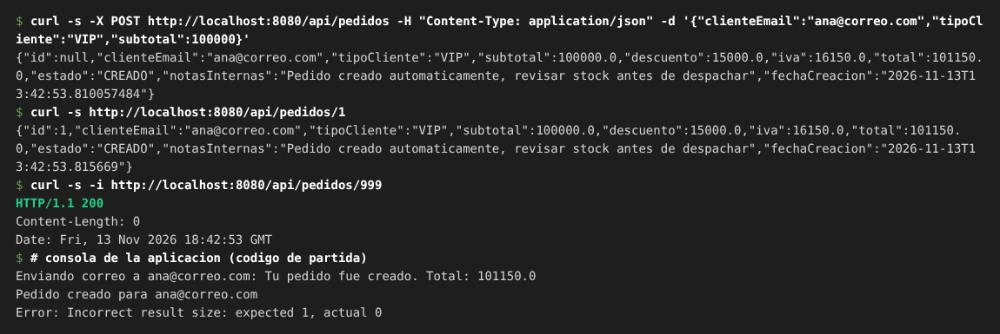

### Parte 1
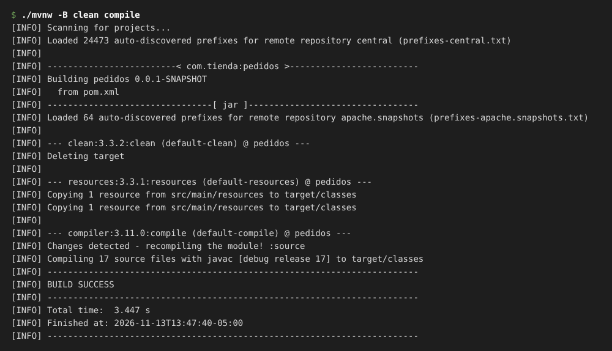
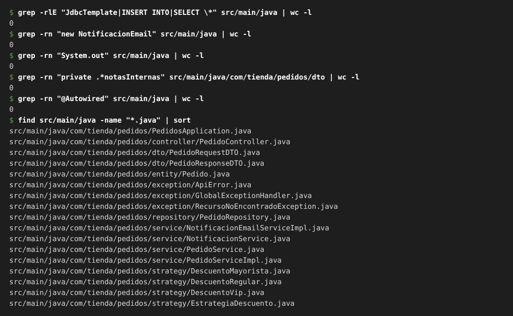
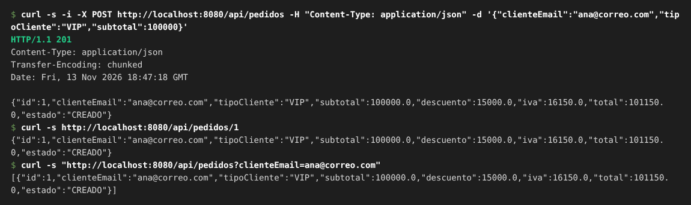
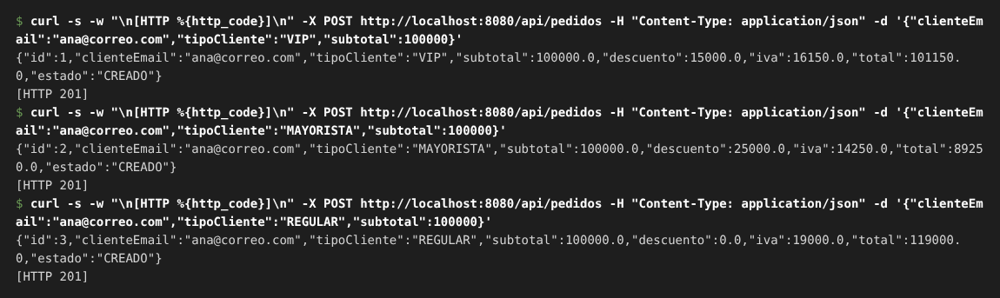

### Parte 2
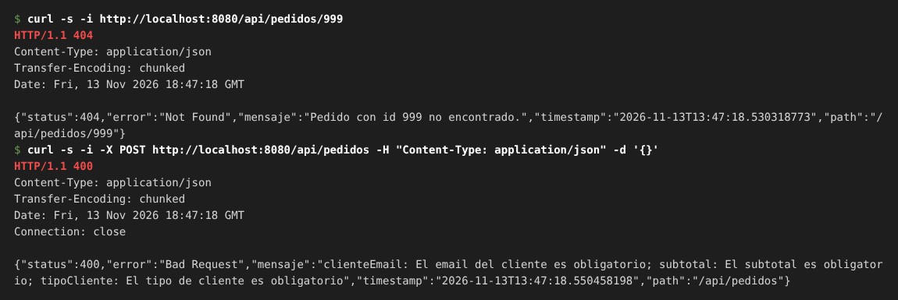
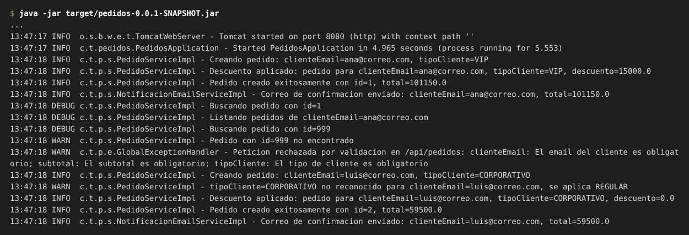
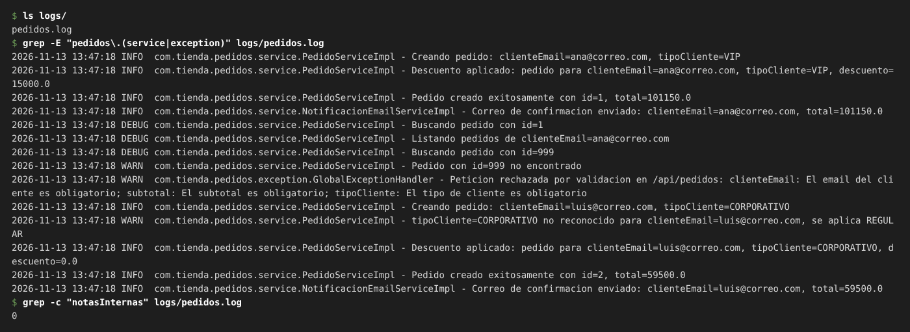
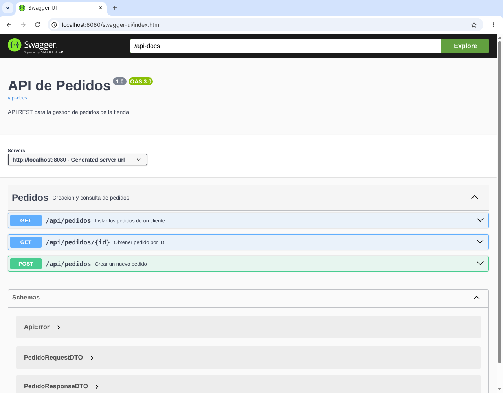
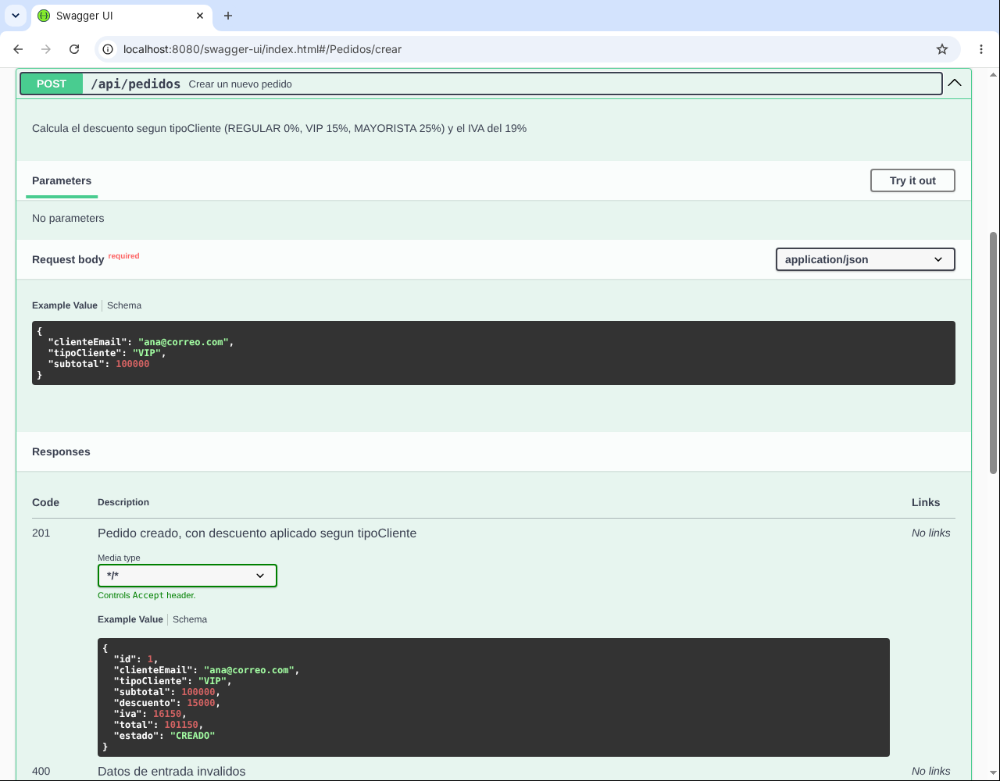
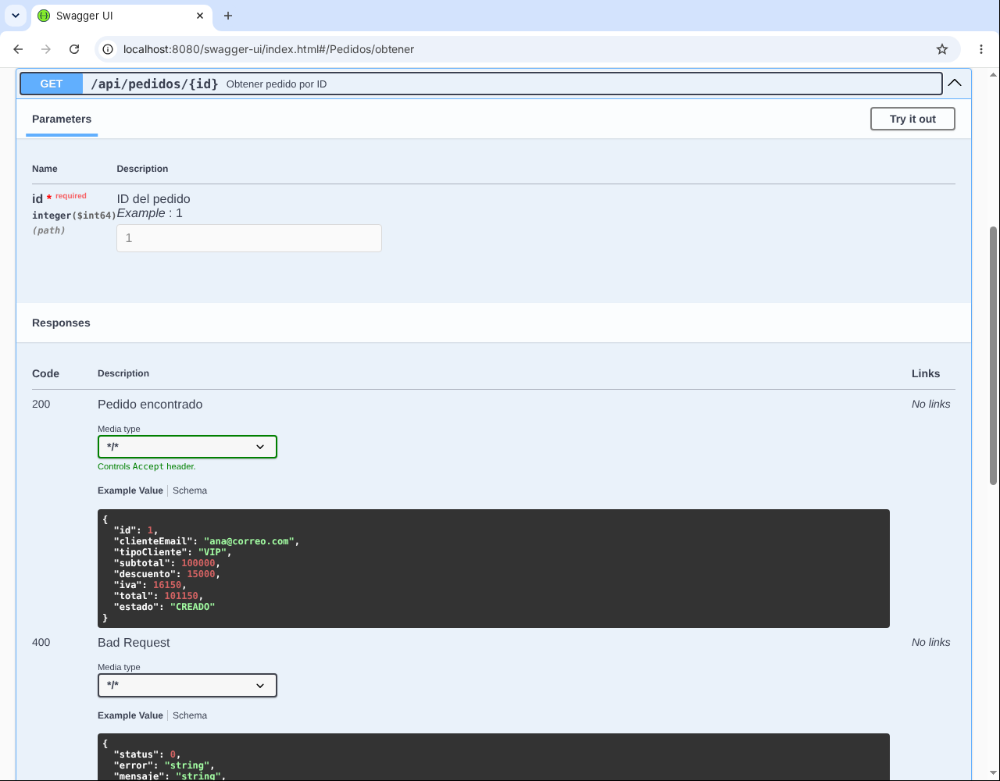
